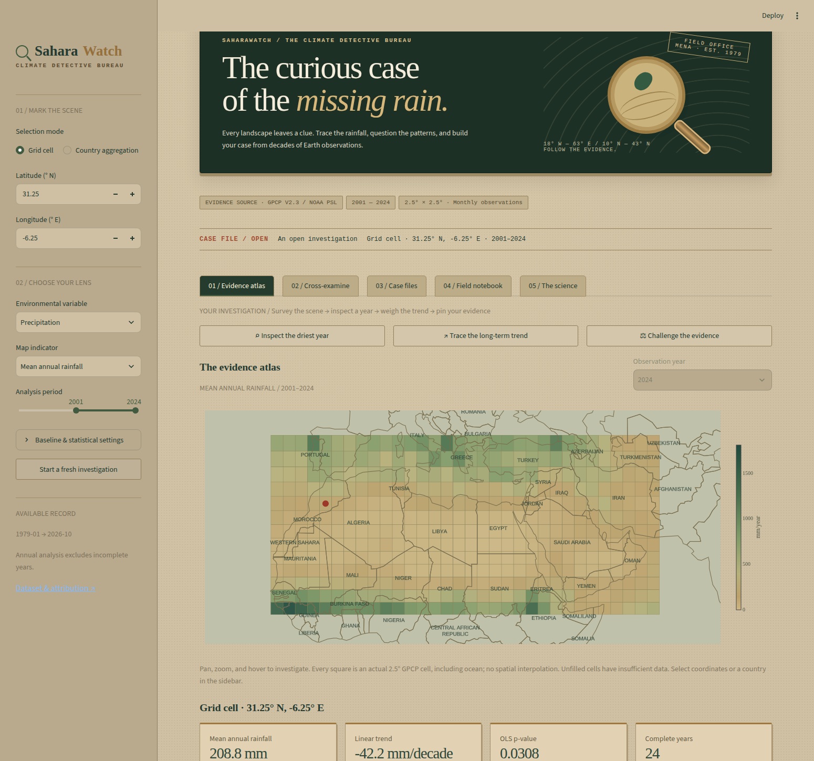

# SaharaWatch

**Earth System Trend Intelligence for MENA.** Investigate historical precipitation across the Middle East and North Africa in a climate detective’s workspace, using real GPCP observations, interactive maps, and transparent statistical analysis.

Built for NASA Space Apps Challenge 2026, **Be An Earth System Trend Detective!** The dashboard connects *what is changing*, *where*, *by how much*, and *with what evidence*. MENA is a useful case study because arid and semiarid climates make rainfall variability and water availability important questions. SaharaWatch supports historical investigation, not drought forecasting or climate attribution.



## Run locally

Use Python **3.12** (tested with 3.12.14). No account, paid API, or GPU is needed.

```bash
python3.12 -m venv .venv
source .venv/bin/activate
pip install -r requirements.txt
python scripts/prepare_data.py
streamlit run app.py
```

Open **http://localhost:8501**. The preparation command downloads the approximately 20 MB source file once. Subsequent runs validate the existing file. To explicitly update it, use `python scripts/prepare_data.py --refresh`. Downloads are validated before replacing an existing valid file. The dashboard never downloads data on interaction and shows an actionable error if the source is missing or malformed.

The prepared dataset in this workspace covers **January 1979–October 2026**; complete calendar years through **2025** are available for annual exploration. The default analysis is **2001–2024**, with a **2001–2020** anomaly baseline. Coverage follows the downloaded file, not a hardcoded latest date.

## Explore

- Pan, zoom, and hover over actual **2.5° cells** in the MENA precipitation map. Geographic context uses local boundaries rather than requiring remote map tiles.
- Switch between annual mean, linear trend, relative trend, annual anomaly, standardized anomaly, and trend significance.
- Choose a grid cell by coordinates, or a country using a boundary mask. All 11 countries in the specification are included.
- Change the analysis window, baseline, anomaly observation year, and significance threshold.
- Inspect annual and monthly rainfall, a fitted annual trend, optional moving averages, seasonal climatology, and anomalies.
- Compare two country series on shared axes, in rainfall units or standardized anomalies.
- Open themed case files, inspect the methodology, and export the selected annual series as CSV.
- Jump to the selected location’s driest year, trace its long-term trend, or challenge the evidence with the significance map.
- Record a working hypothesis in the field notebook and compare it with the calculated trend, including inconclusive results.
- Pin evidence snapshots with their location, analysis period, baseline, source, uncertainty, and field notes. Remove clues or download a Markdown case report. The notebook is session-only; download it before closing or refreshing the session. Starting a fresh investigation clears it.

The interface combines a Victorian detective’s casebook with a drought field station: parchment surfaces, forest-green ink, brass accents, terracotta deficits, a magnifying-glass illustration, and local topographic-style decoration. All chart palettes use the same earth tones; decorative elements do not represent measured geography.

The dashboard uses Streamlit, Plotly, xarray, NumPy, Pandas, SciPy, netCDF4, and Shapely. Source loading, scientific calculations, and plotting are separate small modules in `saharawatch/`; there is no separate backend service.

## Data and provenance

**Primary data:** [GPCP Monthly Precipitation V2.3, NOAA Physical Sciences Laboratory](https://psl.noaa.gov/data/gridded/data.gpcp.html).

[Download the original NetCDF](https://psl.noaa.gov/thredds/fileServer/Datasets/gpcp/precip.mon.mean.nc). Data provided by NOAA PSL, Boulder, Colorado, USA. GPCP combines satellite precipitation estimates and rain-gauge observations and is associated with the NASA-supported GPCP effort. Values are not all direct NASA satellite measurements.

The inspected file has `precip(time, lat, lon)`, units **mm/day**, 72 latitudes, 144 longitudes, and 574 monthly timestamps. The source's `data_comment` marks observations from **November 2021 onward as interim**. The dashboard exposes this comment and the actual dataset version.

Adler, R. F., et al. (2003). *The Version 2 Global Precipitation Climatology Project (GPCP) Monthly Precipitation Analysis (1979–Present).* Journal of Hydrometeorology, 4(6), 1147–1167. The original citation and source metadata are available in the app.

**Boundaries:** [Natural Earth 1:110m Admin 0 countries](https://www.naturalearthdata.com/downloads/110m-cultural-vectors/110m-admin-0-countries/), public domain. The original GeoJSON is bundled in `data/boundaries/countries.geojson`; see its [provenance](data/boundaries/README.md). Boundaries are descriptive, including disputed areas, and do not imply endorsement.

Preparation writes:

| File | Contents |
| --- | --- |
| `data/raw/precip.mon.mean.nc` | Unmodified downloaded source, excluded from Git |
| `data/processed/mena_monthly.nc` | Calendar-aware monthly accumulations for the MENA grid |
| `data/processed/provenance.json` | Source URL, SHA-256, preparation timestamp, schema, coverage, metadata |

The dashboard caches validated data in memory and keys it by source-file modification time and size. Trend grids are cached by the same file identity and selected years; masks by grid coordinates and boundary geometry. It does not repeatedly parse the global file on interaction.

**Source compatibility:** The current file's unused `time_bnds` variable includes unmarked invalid fill dates. The loader excludes only that auxiliary variable from CF decoding, then decodes and validates the actual `time` coordinate. Precipitation values and monthly timestamps are never replaced. This handling is covered by the real-data integration test.

## Scientific methods

**Validation and geography.** The loader checks precipitation metadata, units, dimensions, unique monthly timestamps, coordinate ranges, and 2.5° spacing. Longitudes are converted from 0–360° to −180–180° and sorted. Cell centers inside 10–43° N and 18° W–63° E form the 13 × 32 study grid. Full cell extents are rendered without interpolation. This rectangular domain includes ocean and areas beyond MENA.

**Accumulation and missingness.** Monthly accumulation = mean daily rate × calendar days in the month, including leap days. Annual accumulation sums twelve valid monthly observations per cell. Negative, nonfinite, fill, and values outside the source's declared valid range become missing. Missing years remain missing and cannot become false zero rainfall. Annual controls exclude incomplete calendar years. No imputation occurs.

**Country aggregation.** A Natural Earth polygon includes cells whose centers fall inside it. Fixed membership is combined using cosine-of-latitude weights. A missing member invalidates that regional time step instead of silently changing the sampled area. Boundary cells are not fractionally allocated. Jordan and the UAE each contain only one center at this resolution; these results are approximate coarse-grid country summaries, not precise national rainfall estimates.

**Trend inference.** Ordinary least squares fits annual precipitation against calendar year, using SciPy `linregress`. It requires at least **10 valid annual observations**. The dashboard reports slope in mm/decade, a two-sided zero-slope p-value, and a **95% Student-t slope confidence interval** using n−2 degrees of freedom. Constant series have zero slope and p=1. Relative trends are withheld for mean annual rainfall below **10 mm/year**. Total fitted change uses the elapsed years between first and last valid observations. Missing observations are omitted, with the valid sample size shown.

**Significance maps.** The default is **Benjamini–Hochberg FDR**, applied to all finite cell p-values within the rectangle, including ocean. Raw p-value classification is an explicit alternative. Tooltips always identify raw OLS p-values. Individual selected-location and country statistics remain raw exploratory tests; they do not inherit the map's correction. FDR's usual guarantees assume independent or appropriately positively dependent tests.

**Anomalies.** Annual anomalies subtract the selected baseline's mean annual rainfall. Standardized anomalies divide by its sample standard deviation (ddof=1). Each cell or regional series needs at least **10 valid baseline years**; zero variance produces no standardized result. Monthly anomalies use the same calendar month in the reference period. These standardized anomalies are **not SPI**.

**Uncertainty.** OLS assumes independent residuals and may understate uncertainty for serially correlated precipitation records. A lag-1 annual residual correlation is shown when defined; it is a diagnostic, not a correction. Nonsignificance does not establish no change, statistical significance does not establish causation, and visual comparison does not test whether two country slopes differ significantly. Rainfall deficits describe only one aspect of drought. Coarse cells cannot support city or farm-level claims.

## Test and verify

```bash
pytest -q
python scripts/validate_data.py
```

The tests cover calendar-aware conversion, leap years, complete-year totals, missing and invalid values, coordinate normalization and lookup, weighted regional aggregation, known and constant trend series, p-values and confidence intervals against SciPy, baseline anomalies, zero variance, FDR, and the real GPCP pipeline. Streamlit AppTest exercises indicator switching, period and country changes, monthly view, baseline validation, comparison, guided presets, the missing-data error state, driest-year selection, and evidence snapshot preservation across changes to the analysis period. Real-data tests are explicitly skipped when the raw file is unavailable; run preparation first to exercise them.

Optional browser verification (with the app running on port 8501):

```bash
pip install -r requirements-dev.txt
playwright install chromium
python scripts/browser_smoke.py
```

The browser check verifies rendered plots, country and tab navigation, detective controls, note-taking, report downloads, browser errors, and a 390px mobile viewport. Set `SAHARAWATCH_TEST_URL` to test a local server on another port. It saves screenshots in `assets/`.

## Incomplete and future work

Phase 1 and Phase 2 are implemented. Phase 3 includes CSV export and a Markdown report of pinned evidence; **formal SPI, temperature/MERRA-2 integration, robust autocorrelation-adjusted inference, Theil–Sen/Mann–Kendall tests, and AI-generated interpretation are not implemented**. Deterministic descriptions explain the actual calculations.

Grid-cell selection uses dependable coordinate inputs; map-click selection is not implemented. Comparisons currently support country masks, not two arbitrary grid cells. Fractional country coverage, formal trend-difference testing, and public deployment also remain future work. CSV exports contain measurements and anomalies. Notebook reports capture pinned evidence and notes; they do not include chart images or the underlying full dataset.

For Streamlit Community Cloud, install the pinned requirements and prepare the source file in the deployment environment before launch. The app deliberately does not silently fetch missing data or substitute demo observations. Hosting has not been deployed or verified.
