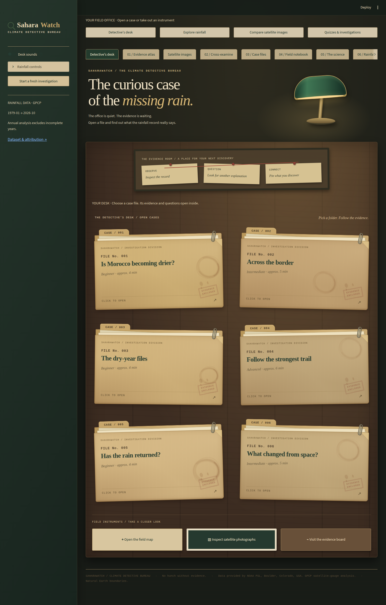
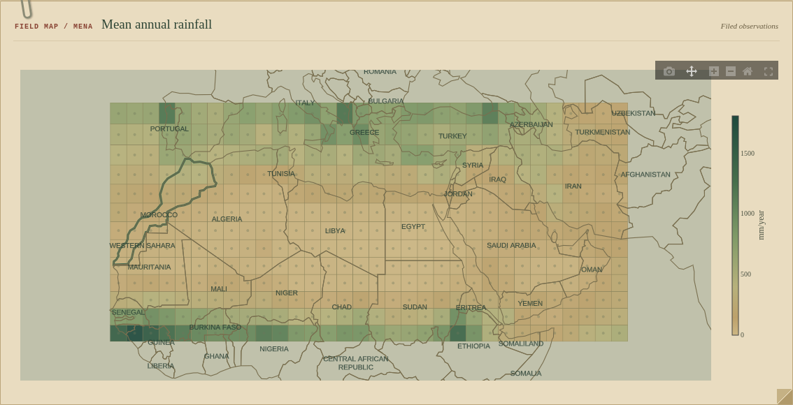
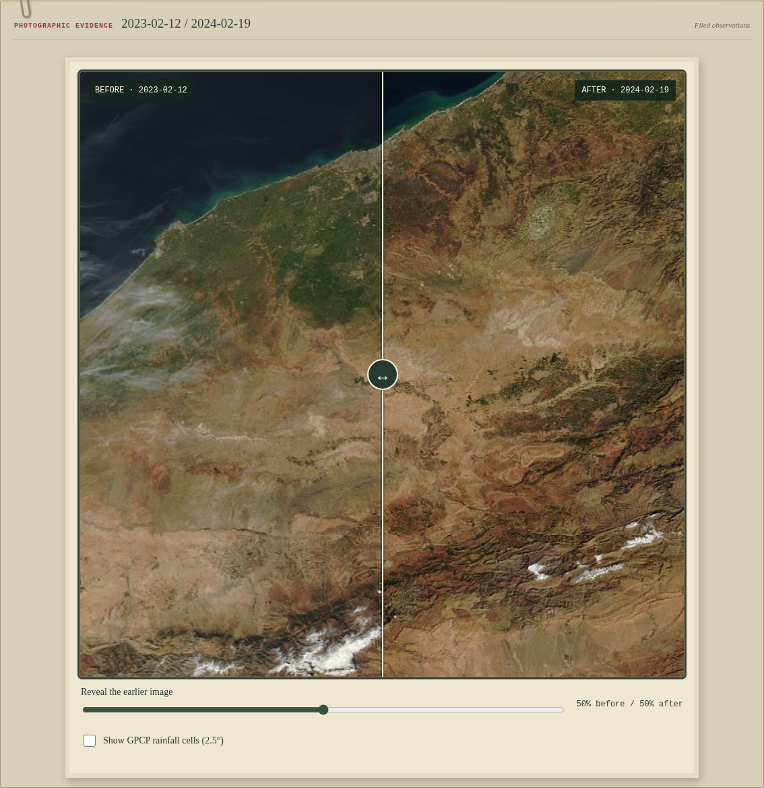
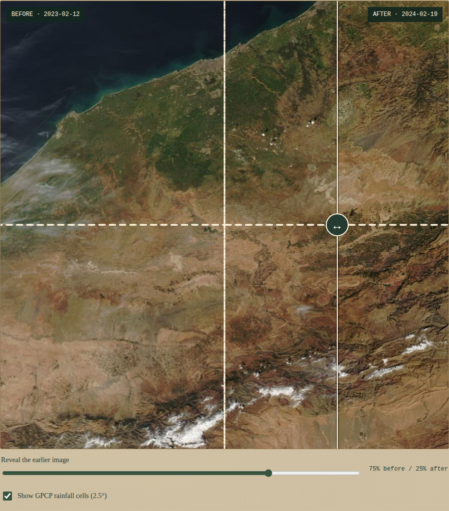
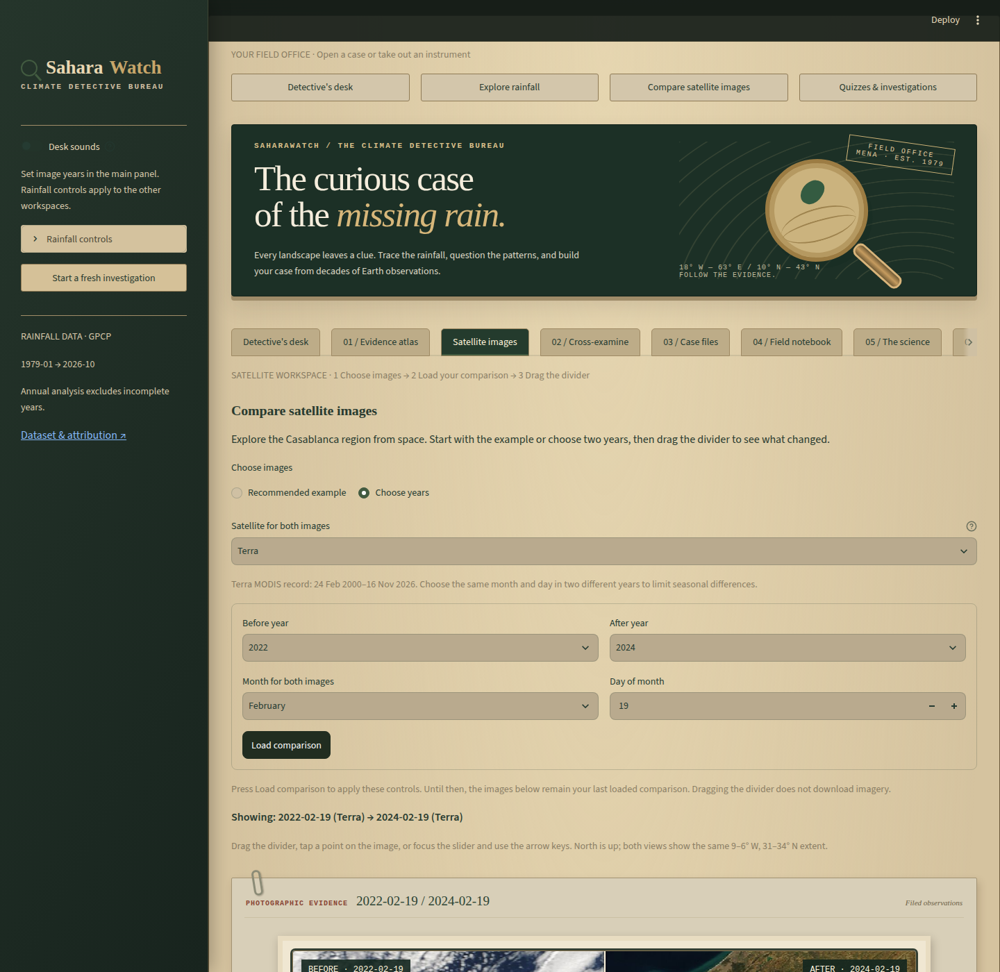
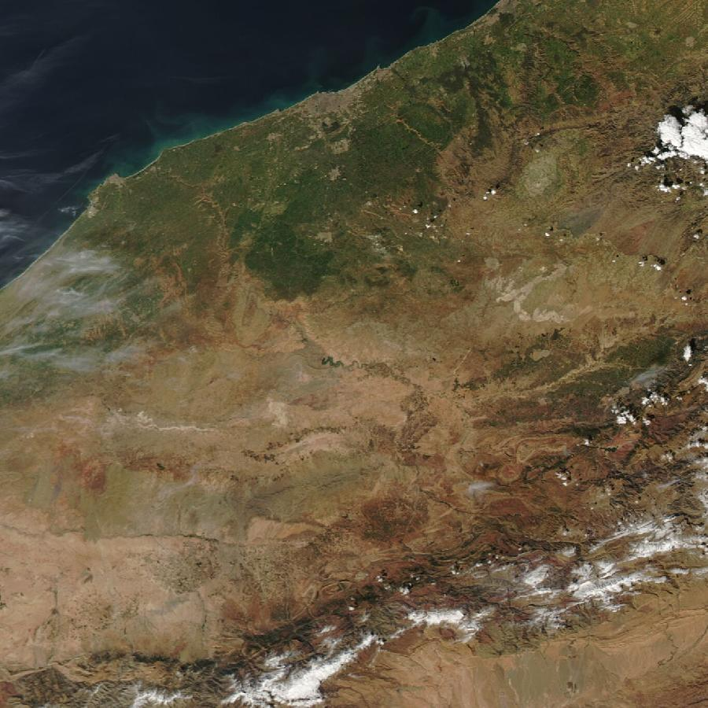
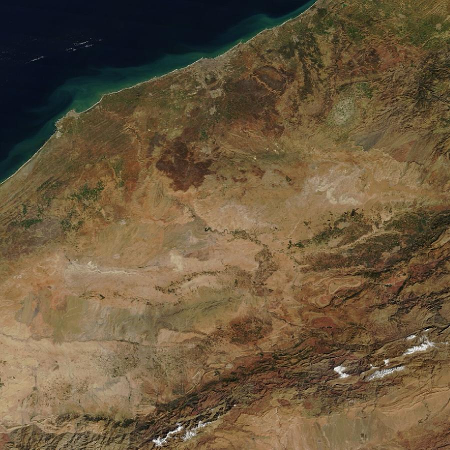
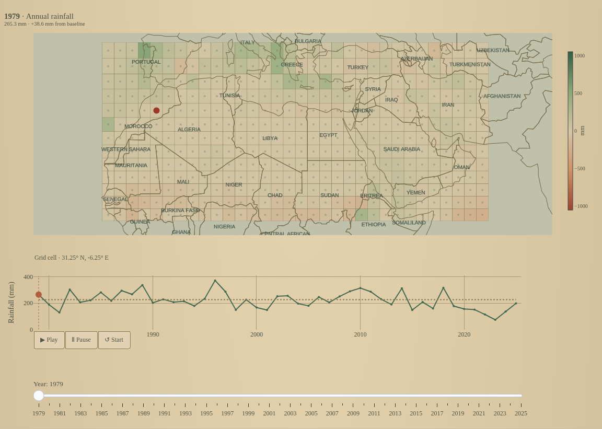
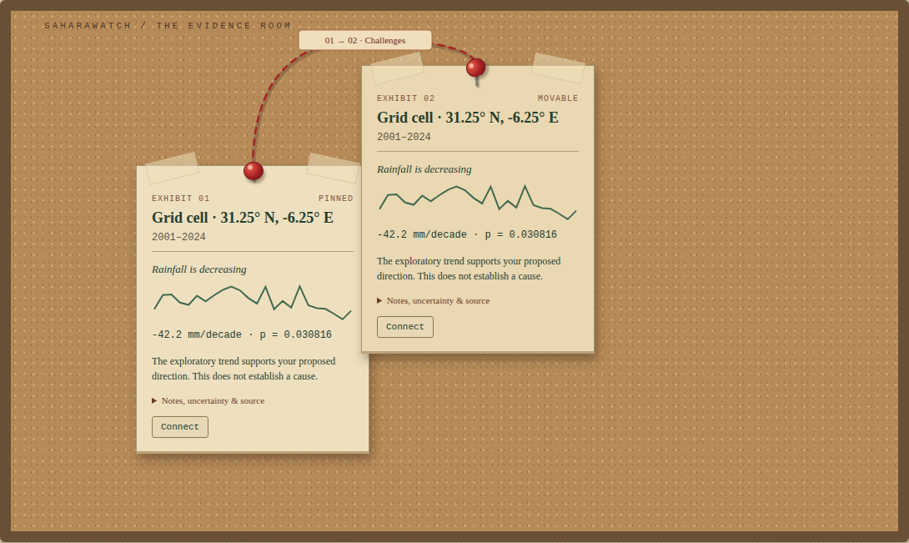

# SaharaWatch

**A playable climate detective’s desk for MENA.** Open a worn case folder, make a hypothesis, inspect real rainfall and satellite evidence, and build a conclusion you can defend. Six cases combine guided quizzes with independent investigations across the Middle East and North Africa.

Built for NASA Space Apps Challenge 2026, **Be An Earth System Trend Detective!** The dashboard connects *what is changing*, *where*, *by how much*, and *with what evidence*. MENA is a useful case study because arid and semiarid climates make rainfall variability and water availability important questions. SaharaWatch supports historical investigation, not drought forecasting or climate attribution.



## Run locally

Use Python **3.12** (tested with 3.12.14). No account, paid API, or GPU is needed.

```bash
python3.12 -m venv .venv
source .venv/bin/activate
pip install -r requirements.txt
streamlit run app.py
```

Open **http://localhost:8501**. The repository includes a validated, approximately 20 MB rainfall snapshot and SHA-256 provenance, so startup needs no data download. Validate it with `python scripts/check_deployment.py`. To intentionally update it, use `python scripts/prepare_data.py --refresh` and review the NetCDF and JSON changes together. Downloads are validated before replacing an existing valid file. Missing or malformed observations produce an actionable error. Custom satellite imagery and temperature observations download only through their explicit load buttons and are cached locally.

**Deploy for free:** use Streamlit Community Cloud with entrypoint `app.py` and Python **3.12**. The repository supplies Python dependencies, Chromium system packages and bundled evidence. See [deployment instructions and release checks](DEPLOYMENT.md) for setup, or use the included Dockerfile on a container host.

## Find your way around

The app starts at **Detective's desk**. Open any folder, choose **Answer the quiz** or **Investigate on your own**, and follow the evidence. For a first visit, try **Case 001 / Is Morocco becoming drier?**

| What you want to do | Where to go |
| --- | --- |
| Open a case or return to your desk | **Detective's desk** → select a folder |
| Inspect rainfall maps and historical charts | **Explore rainfall** → **01 / Evidence atlas** |
| Compare photographs and choose image years | **Compare satellite images** → **Satellite images** |
| Choose a quiz or independent investigation | **Quizzes & investigations** → **03 / Case files** |
| Review pinned clues, connect evidence and export reports | **04 / Field notebook**, or **Visit the evidence board** on the desk |

Open **Rainfall controls** in the sidebar to change the location and analysis period. Satellite image dates are set in the satellite workspace. **Desk sounds** is optional and starts muted. Notes and progress stay in the current session; download reports to keep them.

The prepared dataset in this workspace covers **January 1979–October 2026**; complete calendar years through **2025** are available for annual exploration. The default analysis is **2001–2024**, with a **2001–2020** anomaly baseline. Coverage follows the downloaded file, not a hardcoded latest date.

## Recent country briefings

Immediately below the map in **Evidence atlas**, the **Country briefing** gives a plain-language assessment of the latest three complete calendar years, independently of the long-term analysis window. The current GPCP snapshot defaults to **2023–2025**; incomplete 2026 observations are excluded. Choose another ending year or a 3-, 5-, or 10-year assessment. Changing the briefing country also selects it for the map and historical explorer.

The explanation states whether rainfall deficits persisted, how much accumulated country-average rainfall differed from the selected baseline, how many years were below its annual mean, and whether the latest year improved or deteriorated. **Persistent rainfall deficit** means every assessed year was below the baseline annual mean. **Multi-year rainfall deficit** means cumulative rainfall was below expectation but not every year was dry. **No multi-year rainfall deficit** does not rule out a dry latest year; its rainfall and baseline comparison are stated explicitly. Missing recent years produce **Insufficient data**, not a partial-period estimate.

Expected accumulation is baseline mean annual rainfall × assessment length. Percentage departures are withheld below a 10 mm/year baseline mean. Historical rarity uses an empirical midrank among complete, overlapping windows of the same length wholly within the baseline, with at least ten valid baseline years, ten complete reference windows and nonzero reference-window variability. This is a descriptive comparison, not SPI, a p-value, independent samples, or a future probability. Counts of annual standardized anomalies ≤ −1.5 are reported separately; zero baseline variance withholds these counts.

**Why this assessment?** explains the area-weighted share of included GPCP cells with below-baseline accumulated rainfall, its valid spatial coverage, and agreement or disagreement with the longer-term trend. These cells are compared with their own baselines; the national average does not imply uniform conditions. The cross-country table compares recent precipitation conditions against each country's own reference climate, without ranking drought susceptibility. Source interim-status warnings remain visible. Notebook pins retain the recent period, country explanation, annual observations, spatial weighting, baseline, source checksum and trend context; illustrated reports export the recent country observations separately.

Precipitation deficits are evidence of meteorological dryness, not a complete assessment of agricultural/hydrological drought, vulnerability, impacts, or susceptibility. Soil moisture, evaporative demand, temperature, water availability and exposure require additional evidence. No drought-risk score, official declaration, causal claim, or forecast is generated.

## Explore

- Turn on **Open the rainfall time machine** in Evidence atlas to play annual rainfall anomaly maps alongside a synchronized timeline for the selected grid cell or country. Play, pause, restart, or scrub to a year; choose the full complete-year record or the analysis period and adjust playback speed. The baseline, map color scale, and timeline axes stay fixed throughout playback. Missing observations remain unfilled or gaps, and incomplete calendar years are excluded. Source interim-status notes remain visible. Playback starts paused and runs in the browser without a server request per frame; choose an anomaly indicator and Observation year in the atlas below for further investigation. The animation loads only when enabled, with Plotly bundled locally rather than fetched from a CDN.
- Pan, zoom, and hover over actual **2.5° cells** in the MENA precipitation map. Geographic context uses local boundaries rather than requiring remote map tiles.
- Switch between annual mean, linear trend, relative trend, annual anomaly, relative anomaly, standardized anomaly, and trend significance.
- Click a grid-cell center on the atlas or enter coordinates, or choose a country using a boundary mask. All 11 countries in the specification are included.
- Change the analysis window, baseline, anomaly observation year, and significance threshold.
- Inspect annual and monthly rainfall, a fitted annual trend, optional moving averages, seasonal climatology, and anomalies.
- Compare two countries or two geographic grid cells on shared axes, in rainfall units or standardized anomalies. Each selection includes a historical chart, confidence interval, sample size, recent anomaly, and deterministic comparison of absolute and relative trend magnitudes. Download the summaries as CSV; a separate paired Newey–West HAC test evaluates the common-year linear trend difference.
- Open **03 / Case files** and choose any of six cases: long-term trends, cross-country comparison, annual anomalies, trend magnitude versus significance, recent rainfall recovery, and satellite interpretation. Each case offers **Answer the quiz** and **Investigate on your own**.
- Guided quizzes freeze the observations when opened and ask one question after each of three clues. Feedback explains the supported answer and the misconception behind other choices. Completed quizzes, active attempts and independent drafts stay separate for each case in the session; download reports before closing it.
- Independent investigations let you state a hypothesis, choose countries and periods, inspect live charts, pin evidence as supporting, challenging or contextual, and save a conclusion with one limitation. Completion records the required steps without automatically grading written scientific conclusions. The satellite case links directly to the dedicated comparison workspace.
- Jump to the selected location’s driest year, trace its long-term trend, or challenge the evidence with the significance map.
- Record a working hypothesis in the field notebook and compare it with the calculated trend, including inconclusive results.
- Pin evidence snapshots with their location, analysis period, baseline, source, uncertainty, and field notes. Remove clues or download a Markdown case report. The notebook is session-only; download it before closing or refreshing the session. Starting a fresh investigation clears it.
- Arrange pinned snapshots on the **connected evidence board** in Field notebook. Drag card headings with a mouse or touch; red pushpins lock cards in place. Choose **Supports**, **Challenges**, or **Provides context**, then press **Connect** on two cards to add a labeled red string. Connections record your interpretation, not causation or statistical significance. Positions, locks, and links survive dashboard interactions within the session; removing a clue removes its connections without moving the others. Download the board as JSON to retain the layout, links, and original evidence; Markdown reports also include the relationships. Keyboard users can focus a card heading, use arrow keys to move it, and press Space to toggle its pin. The board scrolls within its frame on small screens.

The interface combines a dim detective’s office with a drought field station: dark timber, lamplight, worn folders, parchment evidence, forest-green ink and brass accents. Charts retain readable earth-tone palettes; decorative elements do not represent measured geography.

The dashboard uses Streamlit, Plotly, xarray, NumPy, Pandas, SciPy, netCDF4, and Shapely. Source loading, scientific calculations, and plotting are separate small modules in `saharawatch/`; there is no separate backend service.

## Feature previews

### The detective’s office

The app opens on a wooden desk under a green banker’s lamp, with six worn case folders and a wall showing your latest pinned clues. Open a folder to continue its quiz or investigation, or use the desk’s field instruments to reach the map, satellite photographs and evidence board. Returning to the desk keeps your session’s casework.

[View the full rainfall workspace](assets/dashboard.png) · [View the desk on mobile](assets/office-landing-mobile.png)

Maps, quiz charts and satellite comparisons sit in labeled evidence mounts. Shadows, clips and paper wear frame the evidence; the observations and image pixels remain unchanged. Completed quizzes and saved investigations receive a filing stamp.

**Desk sounds** in the sidebar is off by default. Enable it for quiet paper movement, pencil feedback and filing sounds, synthesized locally without audio downloads. Folder opening and filing animations respect reduced-motion preferences. All controls remain available with sound disabled.





Run `python scripts/browser_office_smoke.py` to check desk navigation, evidence mounts, opt-in sound, completed-quiz filing and reduced-motion mobile behavior.

### Satellite before/after reveal

Click **Compare satellite images** at the top of the app, or open the **Satellite images** tab beside the rainfall atlas. Images appear immediately: no quiz, hypothesis, or reveal toggle is required. The recommended example compares Aqua MODIS on **12 February 2023** with Terra MODIS on **19 February 2024**, over the same 9–6° W, 31–34° N extent around Casablanca.



**Choose your own years:** select **Choose years**, choose Terra or Aqua MODIS, set a **Before year** and **After year**, and choose a common month/day. Press **Load comparison** to request those exact dates from NASA GIBS. The displayed **Showing** label always states the dates and platforms of the images actually loaded. Controls do not relabel an old image while a new selection is pending.



[View the year controls on mobile](assets/satellite-year-controls-mobile.png).

The app checks NASA's actual time-domain catalogue, including known gaps. Invalid dates, reversed or equal years, future dates, unreadable responses, and blank imagery produce an explanation while retaining the previous comparison. No nearby date is silently substituted. Clouds, haze and snow can still obscure valid imagery; change the common day to inspect another acquisition. Transparent missing-data area is distinguished from valid pixels; valid-image coverage is **not** a cloud-free percentage.

Custom comparisons use the same satellite, output extent, projection, month and day in both years. Exact original PNG responses, request URLs, timestamps, checksums, and valid-image area are cached under ignored `data/raw/satellite/`. New images are fetched only after **Load comparison**; dragging the divider, changing rainfall filters, or returning to a previously downloaded pair reuses local observations. The recommended example is bundled and remains available without a network connection.

The rainfall chart marks the loaded acquisition dates and shows the nearest GPCP cell to Casablanca. Separate six-month totals cover complete months before each acquisition month; missing observations withhold the corresponding total. Monthly bars include days after acquisition and cannot resolve individual rainfall events. The optional overlay shows actual **2.5° GPCP cell boundaries**, rather than suggesting that image detail increases rainfall resolution. Rainfall sidebar settings are collapsed in this workspace and do not change image dates.

Download the evidence ZIP for both original images, monthly rainfall CSV and the loaded pair's provenance. **Investigate this comparison** opens **Case 006 → Investigate on your own**, carrying the current dates into evidence pins and saved reasoning. The Case 006 quiz uses the fixed 2023/2024 teaching example and labels it separately.

The original example, with matching geographic extent:

| Before · 12 February 2023 · Aqua MODIS | After · 19 February 2024 · Terra MODIS |
| --- | --- |
|  |  |

[View the comparison on mobile](assets/satellite-comparison-mobile.png). See [image provenance and limits](data/satellite/README.md), [NASA's original context](https://science.nasa.gov/earth/earth-observatory/drought-parches-morocco-152467/) and [GIBS time-domain documentation](https://nasa-gibs.github.io/gibs-api-docs/access-basics/).

Run `python scripts/browser_satellite_smoke.py` for the bundled comparison or `python scripts/browser_satellite_years_smoke.py` for custom-year loading and handoff; set `SAHARAWATCH_TEST_URL` to use another port. The custom-year check requires NASA access or a previously cached catalogue and image pair.

### Six cases, two ways to investigate

Open **03 / Case files**. The shared selector and path choice appear first, labeled as steps 1 and 2, with difficulty, estimated duration, and separate quiz/investigation completion status. The six cases sit on a detective’s wooden desk as worn manila folders, with paper tabs, clips, pencilled details, coffee rings, and evidence stamps. Click anywhere on a folder to fold its cover open and reveal its field notes; the quiz or investigation below switches to that case. The active folder stays open. Folders also work with keyboard and touch, and opening motion is disabled when reduced motion is preferred.

| Case | Investigation |
| --- | --- |
| 001 · Is Morocco becoming drier? | Fitted direction, statistical uncertainty and attribution limits |
| 002 · Across the border | Morocco–Algeria magnitudes and a paired HAC slope-difference test |
| 003 · The dry-year files | Annual anomalies, a −1.5 standardized-anomaly threshold and the one-year trap |
| 004 · Follow the strongest trail | Trend rankings, FDR flags and the distinction from drought risk |
| 005 · Has the rain returned? | Latest three complete years, accumulated deficits and spatial differences |
| 006 · What changed from space? | Satellite platforms, rainfall resolution and limits of visual attribution |

**Answer the quiz:** record an initial hypothesis, open a frozen attempt, and answer a question after each of three clues. Check an answer to see the supported choice, its numerical or conceptual explanation, and feedback on the selected alternative. Incorrect answers do not block learning; the first-attempt score remains recorded. Unsupported numerical assessments offer **Insufficient data**. Quiz answers follow the observations and selected method rather than preset climate conclusions. Each answered clue can be pinned to the notebook. Download a solved quiz as JSON, including observations, charts, answers, settings and source provenance, or continue directly into an independent investigation.

**Investigate on your own:** write a hypothesis, choose a country and investigation/reference periods, then explore the live evidence with optional hints. These period controls are independent of the sidebar. The cross-country case lets you choose a partner; the anomaly and ranking cases investigate the MENA rectangle, including ocean cells. The recent-rainfall case supports 3-, 5- or 10-year assessments. The satellite investigation uses the pair currently loaded in the dedicated Satellite images workspace. Pin observations with an interpretation and note, then write a conclusion and limitation. Saving requires all four steps: hypothesis, pinned evidence, conclusion, limitation. The app records completion without deciding whether the prose is scientifically correct. JSON exports preserve the saved evidence and reasoning; save again after edits to update the download.


[View an open folder on mobile](assets/case-folder-mobile.png).

Attempts, completed reports, independent drafts, and pinned clues survive switching cases within the session. Restarting a quiz uses current settings while retaining completed reports and pins. **Start a fresh investigation** clears session state. Download reports before closing or refreshing the session. Quizzes are deterministic; no language-model service is needed.

Case 005 retains its historical rainfall-balance calculations and three evidence charts. Its quiz always uses the latest three complete calendar years, independently of the analysis-period slider. Its reference baseline and weighting freeze on opening. The independent version uses the investigation period's ending year. Neither version establishes drought impacts, causes, or future conditions.

Verify the flow with `python scripts/browser_case_library_smoke.py` against a running app, or set `SAHARAWATCH_TEST_URL` for another port. `python scripts/browser_mystery_smoke.py` checks the Case 005 quiz specifically.

Run `python scripts/browser_folders_smoke.py` to verify full-cover folder selection, opening state, keyboard, touch, reduced motion and mobile layout.

### Rainfall time machine

Play through annual rainfall anomaly maps with a synchronized timeline, a year scrubber, and fixed scales. Open it from **01 / Evidence atlas → Open the rainfall time machine**.



### Connected evidence board

Drag evidence cards across the cork board, lock them with red pushpins, and connect findings with labeled red strings. Find it in **04 / Field notebook** after pinning evidence.



## Data and provenance

**Primary data:** [GPCP Monthly Precipitation V2.3, NOAA Physical Sciences Laboratory](https://psl.noaa.gov/data/gridded/data.gpcp.html).

[Download the original NetCDF](https://psl.noaa.gov/thredds/fileServer/Datasets/gpcp/precip.mon.mean.nc). Data provided by NOAA PSL, Boulder, Colorado, USA. GPCP combines satellite precipitation estimates and rain-gauge observations and is associated with the NASA-supported GPCP effort. Values are not all direct NASA satellite measurements.

The inspected file has `precip(time, lat, lon)`, units **mm/day**, 72 latitudes, 144 longitudes, and 574 monthly timestamps. The source's `data_comment` marks observations from **November 2021 onward as interim**. The dashboard exposes this comment and the actual dataset version.

Adler, R. F., et al. (2003). *The Version 2 Global Precipitation Climatology Project (GPCP) Monthly Precipitation Analysis (1979–Present).* Journal of Hydrometeorology, 4(6), 1147–1167. The original citation and source metadata are available in the app.

**Boundaries:** [Natural Earth 1:110m Admin 0 countries](https://www.naturalearthdata.com/downloads/110m-cultural-vectors/110m-admin-0-countries/), public domain. The original GeoJSON is bundled in `data/boundaries/countries.geojson`; see its [provenance](data/boundaries/README.md). Boundaries are descriptive, including disputed areas, and do not imply endorsement.

Preparation writes:

| File | Contents |
| --- | --- |
| `data/raw/precip.mon.mean.nc` | Unmodified source snapshot, included for reproducible deployment |
| `data/raw/precip.mon.mean.json` | Bundled snapshot provenance and SHA-256 |
| `data/processed/mena_monthly.nc` | Calendar-aware monthly accumulations for the MENA grid |
| `data/processed/provenance.json` | Source URL, SHA-256, preparation timestamp, schema, coverage, metadata |

The dashboard caches validated data in memory and keys it by source-file modification time and size. Trend grids are cached by the same file identity and selected years; masks by grid coordinates and boundary geometry. It does not repeatedly parse the global file on interaction.

**Source compatibility:** The current file's unused `time_bnds` variable includes unmarked invalid fill dates. The loader excludes only that auxiliary variable from CF decoding, then decodes and validates the actual `time` coordinate. Precipitation values and monthly timestamps are never replaced. This handling is covered by the real-data integration test.

## Scientific methods

**Validation and geography.** The loader checks precipitation metadata, units, dimensions, unique monthly timestamps, coordinate ranges, and 2.5° spacing. Longitudes are converted from 0–360° to −180–180° and sorted. Cell centers inside 10–43° N and 18° W–63° E form the 13 × 32 study grid. Full cell extents are rendered without interpolation. This rectangular domain includes ocean and areas beyond MENA.

**Accumulation and missingness.** Monthly accumulation = mean daily rate × calendar days in the month, including leap days. Annual accumulation sums twelve valid monthly observations per cell. Negative, nonfinite, fill, and values outside the source's declared valid range become missing. Missing years remain missing and cannot become false zero rainfall. Annual controls exclude incomplete calendar years. No imputation occurs.

**Country aggregation.** A Natural Earth polygon includes cells whose centers fall inside it. Fixed membership is combined using cosine-of-latitude weights. A missing member invalidates that regional time step instead of silently changing the sampled area. In the optional **Fractional area** mode, cell/country polygon intersections are measured in EPSG:6933 after densifying edges to 0.1°. These physical overlap areas replace the binary/cosine weights. This assumes a uniform GPCP-cell value over each intersected part; it improves geographic allocation without inventing finer rainfall resolution. Jordan and the UAE each contain only one center at this resolution; these results are approximate coarse-grid country summaries, not precise national rainfall estimates.

**Trend inference.** Ordinary least squares fits annual precipitation against calendar year, using SciPy `linregress`. It requires at least **10 valid annual observations**. The dashboard reports slope in mm/decade, a two-sided zero-slope p-value, and a **95% Student-t slope confidence interval** using n−2 degrees of freedom. Constant series have zero slope and p=1. Relative trends are withheld for mean annual rainfall below **10 mm/year**. Total fitted change uses the elapsed years between first and last valid observations. Missing observations are omitted, with the valid sample size shown.

**Significance maps.** The default is **Benjamini–Hochberg FDR**, applied to all finite cell p-values within the rectangle, including ocean. Raw p-value classification is an explicit alternative. Tooltips identify unadjusted p-values from the selected inference method. Individual selected-location and country statistics use the selected inference method without the map's spatial multiple-testing adjustment. FDR's usual guarantees assume independent or appropriately positively dependent tests.

**Anomalies.** Annual anomalies subtract the selected baseline's mean annual rainfall. Standardized anomalies divide by its sample standard deviation (ddof=1). Each cell or regional series needs at least **10 valid baseline years**; zero variance produces no standardized result. Monthly anomalies use the same calendar month in the reference period. These standardized anomalies are **not SPI**.

**Uncertainty.** OLS assumes independent residuals and may understate uncertainty for serially correlated precipitation records. A lag-1 annual residual correlation is shown when defined; it is a diagnostic, not a correction. The **Statistical trend diagnostics** expander additionally compares ordinary OLS with Newey–West HAC inference for the selected annual series. HAC uses a Bartlett kernel, lag `floor(4 × (n/100)^(2/9))`, small-sample covariance correction, and Student-t inference with n−2 degrees of freedom. It requires ten consecutive valid annual observations and is withheld for gaps. The fitted OLS slope is unchanged; 95% confidence intervals and p-values use the robust covariance. Small samples still limit reliability. A descriptive Theil–Sen slope checks sensitivity to outliers without claiming autocorrelation-adjusted significance. Downloadable diagnostics preserve the method and location; the sidebar method selector applies OLS, HAC, or modified Mann–Kendall to maps, comparisons, guided cases, and notebook snapshots. The map applies optional FDR after the chosen inference method. Nonsignificance does not establish no change, statistical significance does not establish causation, and visual comparison does not test whether two country slopes differ significantly. Rainfall deficits describe only one aspect of drought. Coarse cells cannot support city or farm-level claims.

## Features 3 and 4: rainfall deficits and SPI

Open **06 / Rainfall deficits & SPI** for annual or monthly absolute, relative, and standardized precipitation anomalies, configurable negative-anomaly thresholds, and CSV exports. The default anomaly baseline remains **2001–2020** and can be changed in the sidebar. Monthly comparisons use the same calendar month. Relative departures are withheld below an expected **1 mm/month** or **10 mm/year**; all anomaly calculations need at least ten valid baseline observations per group. A frequency summary counts standardized anomalies at or below the selected negative threshold, excluding missing observations from its denominator. It is labeled **Frequency of severe negative precipitation anomalies**, not official drought frequency.

Enable **validated gamma SPI** for the selected grid-cell or country series. Choose **SPI-3** or **SPI-12** and an independent calibration period (default **1981–2010**) spanning at least 30 years. This leaves the anomaly reference period unchanged. The pinned [climate-indices 3.1.0 implementation](https://climate-indices.readthedocs.io/en/stable/algorithm-reference.html) fits a two-parameter gamma distribution to accumulated monthly rainfall separately by calendar month, accounts for the calibration-period probability of zero accumulation using its classic convention, and transforms the fitted cumulative probability with the inverse normal CDF. The library clips scores to ±3.09. SPI is not an ordinary anomaly z-score.

Each calendar month must have at least **30 valid accumulated calibration observations**, **20 positive accumulations**, and nonzero variability among positive accumulations. Results are also withheld where the library's gamma-fit KS diagnostic is missing or below 0.05. This is a conservative reliability screen; its p-value is not a formal goodness-of-fit test adjusted for parameter estimation. Fitting warnings are shown. Unsupported months stay missing, and insufficient calibration periods show an explanation rather than a substitute index.

Rolling accumulations retain observations before the analysis period. Missing calendar months are made explicit as missing, invalidating all affected rolling windows. SPI is computed only when enabled for the selected series and cached by observations, dates, scale, and calibration years. It does not fit every map cell at startup. The validated tests compare supported SPI observations against both the reference library and an independent gamma-CDF calculation, including zero precipitation and temporal gaps. Zero-inflated arid climates can limit SPI interpretation even with these checks.

SPI export includes accumulation, score, scale, and calibration years. To exercise the new browser controls and CSV downloads with the app running, use `python scripts/browser_drought_smoke.py` after installing the development requirements. Use `python scripts/browser_investigations_smoke.py` to verify Features 5–7, including diagnostic and comparison exports, all four guided cases, and the ranked map.

## Test and verify

```bash
pip install -r requirements-dev.txt
python -m playwright install --with-deps chromium
python scripts/check_deployment.py --render-report
pytest -q
python scripts/validate_data.py
```

The tests cover calendar-aware conversion, leap years, complete-year totals, missing and invalid values, coordinate normalization and lookup, weighted regional aggregation, known and constant trend series, p-values and confidence intervals against SciPy, baseline anomalies, zero variance, FDR, and the real GPCP pipeline. Streamlit AppTest exercises indicator switching, period and country changes, monthly view, baseline validation, comparison, guided presets, the missing-data error state, driest-year selection, and evidence snapshot preservation across changes to the analysis period. Real-data tests are explicitly skipped when the raw file is unavailable; run preparation first to exercise them.

Optional browser verification (with the app running on port 8501):

```bash
pip install -r requirements-dev.txt
playwright install chromium
python scripts/browser_smoke.py
python scripts/browser_office_smoke.py
python scripts/browser_time_machine_smoke.py
python scripts/browser_board_smoke.py
```

The browser check verifies rendered plots, country and tab navigation, detective controls, note-taking, report downloads, browser errors, and a 390px mobile viewport. Set `SAHARAWATCH_TEST_URL` to test a local server on another port. It saves screenshots in `assets/`.

To refresh the desk, physical map and photographic evidence previews, run `python scripts/browser_office_smoke.py`. Use `python scripts/capture_readme.py` for the dashboard, evidence board and rainfall playback. The folder and satellite browser checks refresh their corresponding desktop and mobile previews. Set `SAHARAWATCH_TEST_URL` to the running app's URL when using a port other than 8501.

## Additional local improvements

**Temperature:** select **Temperature at 2 m · NASA POWER** in Environmental variable, choose a coordinate, and click **Load real temperature observations**. One monthly point request retrieves T2M, using [NASA POWER's MERRA-2-backed monthly service](https://power.larc.nasa.gov/docs/services/api/temporal/monthly/). Requests use coordinates rounded to 0.01°, well below the native meteorological grid support. No temperature requests run on startup. Raw JSON, API/source headers, request URL, SHA-256, and recording time are retained in `data/raw/power/`; CSV and provenance exports are provided. A country selection supplies only a starting point, never a national temperature average. Annual temperature is the day-weighted mean of twelve monthly means, in °C, with incomplete years withheld. Coverage begins in 1981; no earlier data or alternative anomaly baseline is silently substituted. Temperature and nearest-cell GPCP annual series are aligned on common years, with differing spatial supports explicitly stated. To prepare or inspect a point from the command line:

```bash
python scripts/prepare_temperature.py --latitude 31.25 --longitude -6.25 --start 1981 --end 2024
```

**Inference across views:** the sidebar selects independent-residual OLS, Newey–West HAC, or **Hamed–Rao modified Mann–Kendall** using the pinned pyMannKendall implementation. Modified MK adjusts its tie-corrected rank variance for significant detrended-rank autocorrelations at up to three annual lags, using a fixed 5% autocorrelation screen. The user-selected α changes trend classification and FDR decisions, not this variance estimate. It uses a Sen slope; an autocorrelation-adjusted slope confidence interval is not claimed. HAC and modified MK require ten consecutive valid annual observations; invalid MK variance produces no p-value. These are exploratory choices, not guarantees against climate-model misspecification or small-sample error. FDR operates on each map's selected method p-values; magnitude and significance remain separate.

**Regional differences:** the formal comparison fits first-minus-second annual rainfall over common years with HAC covariance, retaining contemporaneous cross-region covariance rather than treating the two estimates as independent. It requires ten consecutive common valid years and reports the linear slope difference, confidence interval, p-value, lag and sample size. It tests linear slopes even when individual series use MK. The original magnitude comparison is descriptive and does not itself establish a significant difference.

**Illustrated reports:** pin evidence in the notebook, then **Build illustrated investigation report**. The ZIP contains a self-contained HTML report with embedded PNG charts, separate PNG files, pinned annual observations as CSV, and JSON evidence with method, weighting and source checksum. Images use the pinned data and filters, not the current view. User notes are escaped in HTML. Adding/removing clues invalidates the prepared archive until rebuilt. Open `report.html` locally or print it to PDF from a browser. PNG rendering needs Chrome/Chromium and Kaleido; the app reuses the installed Playwright Chromium when present, or Kaleido's configured browser (`BROWSER_PATH`). On another machine, install Chromium or run `plotly_get_chrome` before building an illustrated report. Basic CSV and Markdown exports do not need a rendering browser.

Run `python scripts/browser_improvements_smoke.py` against the local app to verify actual map clicks, robust methods, fractional country aggregation, illustrated-report downloads, and real NASA POWER temperature exports. The scientific suite also validates these calculations and artifacts.

## Remaining limitations

Temperature integration is point-based, not a regional temperature map or national aggregation. Country summaries still use coarse GPCP cell values and generalized Natural Earth boundaries, even with fractional areas. MK supplies no autocorrelation-adjusted slope CI. SPI remains a selected-series calculation. Interpretations remain deterministic; no paid or local language model is required. These scientific scope limits are explicit in the interface and are not substituted with synthetic observations.

Deployment configuration is provided for Streamlit Community Cloud and Docker. No public deployment is performed automatically; verify your hosted URL using [DEPLOYMENT.md](DEPLOYMENT.md). Session progress is not permanent storage, and free-host resource limits still apply.

## License and security

SaharaWatch's original code and documentation are licensed under the [MIT License](LICENSE), copyright 2026 Badr Elafi. Bundled third-party datasets, imagery and dependencies retain their respective terms and attribution; see [NOTICE.md](NOTICE.md) and the provenance documents under `data/`. No NASA or NOAA endorsement is implied.

See [SECURITY.md](SECURITY.md) for private vulnerability reporting, publication privacy and deployment guidance. CI checks Git history for secrets and audits Python dependencies; Dependabot proposes dependency updates for review. GitHub's secret scanning, push protection and private-reporting settings must be enabled separately by a repository administrator.
